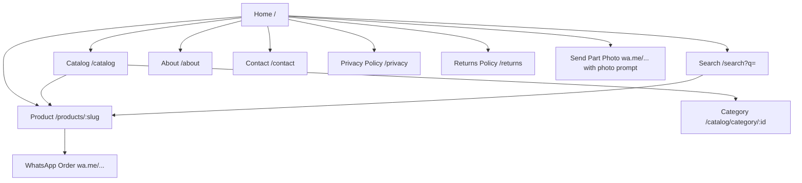

# AZZAB MOTO — Architecture Document

> **Project:** عزاب موتو — TVS Motorcycle Spare-Parts Store  
> **Package:** Starter Store  
> **Status:** Phase 0 — Planning

---

## 1. Scaffolding Reality Check

The repository was initialised with the **Vite + React 19 + Oxlint** starter template only.  
The following are **NOT yet present** and will be installed in Phase 1:

| Tool                                  | Required | Status                                                          |
| ------------------------------------- | -------- | --------------------------------------------------------------- |
| TypeScript                            | ✅       | ❌ Missing — `.jsx` files, no `tsconfig.json`                   |
| Tailwind CSS v4 (`@tailwindcss/vite`) | ✅       | ❌ Missing                                                      |
| shadcn/ui                             | ✅       | ❌ Missing                                                      |
| react-router-dom                      | ✅       | ❌ Missing                                                      |
| zod                                   | ✅       | ❌ Missing                                                      |
| react-helmet-async                    | ✅       | ❌ Missing                                                      |
| lucide-react                          | ✅       | ❌ Missing                                                      |
| @fontsource/tajawal                   | ✅       | ❌ Missing                                                      |
| @fontsource/ibm-plex-sans-arabic      | ✅       | ❌ Missing                                                      |
| @fontsource/ibm-plex-mono             | ✅       | ❌ Missing                                                      |
| vitest + @testing-library             | ✅       | ❌ Missing                                                      |
| eslint-plugin-security                | ✅       | ❌ Missing                                                      |
| eslint-plugin-jsx-a11y                | ✅       | ❌ Missing                                                      |
| prettier                              | ✅       | ❌ Missing                                                      |
| docs/ folder                          | ✅       | ❌ Missing (created in Phase 0)                                 |
| docs/design-brief.md                  | ✅       | ❌ **CLIENT MUST PROVIDE** (see Open Questions)                 |
| docs/proposal.pdf                     | ✅       | ❌ **CLIENT MUST PROVIDE** (see Open Questions)                 |
| src/assets/logo.png                   | ✅       | ❌ **CLIENT MUST PROVIDE** — hero.png exists, logo.png does not |

Phase 1 will install all missing tools, convert files to TypeScript, and establish the full folder skeleton.

---

## 2. High-Level Architecture

```
┌───────────────────────────────────────────────────────────────┐
│                        Browser (PWA)                          │
└───────────────────────────────────────────────────────────────┘
                              │
                    ┌─────────▼──────────┐
                    │   React App Shell   │
                    │  (Router, Providers,│
                    │   Error Boundary)   │
                    └─────────┬──────────┘
          ┌───────────────────┼───────────────────┐
          │                   │                   │
   ┌──────▼──────┐   ┌────────▼────────┐  ┌──────▼──────┐
   │  Features   │   │    Shared UI    │  │  Services   │
   │  (feature   │   │  (shadcn/ui +   │  │ (Repository │
   │   folders)  │   │  design tokens) │  │  pattern)   │
   └──────┬──────┘   └─────────────────┘  └──────┬──────┘
          │                                       │
          │  import only through index.ts         │
          │                                       │
   ┌──────▼──────────────────────────────────────▼──────┐
   │                    Data Layer                       │
   │   src/data/*.json  →  JsonRepository (Starter)     │
   │   [future] ApiRepository (Business/Premium)        │
   └─────────────────────────────────────────────────────┘
```

---

## 3. Folder Structure

```
src/
├── app/
│   ├── providers/          # React context providers (theme, etc.)
│   ├── router/             # Route definitions, lazy imports
│   ├── layouts/            # MainLayout (header+footer), BlankLayout
│   └── config/
│       ├── site.ts         # Store name, phone, whatsapp, flags
│       └── features.ts     # Feature flags (cart=false, accounts=false …)
│
├── features/
│   ├── catalog/            # Product grid, category browse
│   │   ├── components/
│   │   ├── hooks/
│   │   ├── types.ts
│   │   └── index.ts        # ← PUBLIC API only
│   ├── product/            # Product detail page
│   ├── search/             # Search bar, results
│   ├── vehicle-selector/   # Model / year / category picker
│   ├── whatsapp-order/     # WA link builder + unit tests
│   └── static-pages/       # About, Contact, Privacy, Returns
│
├── shared/
│   ├── ui/                 # shadcn components (re-exported)
│   ├── hooks/              # useScrollIn, usePreferReducedMotion …
│   ├── lib/
│   │   ├── storage.ts      # Typed localStorage wrapper
│   │   └── whatsapp.ts     # WA URL builder (security-critical)
│   ├── utils/              # cn(), formatPrice(), sanitizeSearch()
│   └── types/              # Global shared TS types
│
├── services/
│   ├── interfaces/         # ProductRepository, CategoryRepository, VehicleRepository
│   └── json/               # JsonProductRepository, etc. (reads src/data/)
│
├── data/
│   ├── products.json
│   ├── models.json
│   └── categories.json
│
└── styles/
    ├── tokens.css          # ALL design tokens as CSS custom properties
    ├── global.css          # Base reset + RTL baseline
    └── motion.css          # Animation keyframes + reduced-motion overrides
```

---

## 4. Data Flow

```
URL param / user action
        │
        ▼
   Feature hook  (e.g., useCatalog)
        │  calls
        ▼
   Repository interface  (ProductRepository)
        │  implemented by
        ▼
   JsonRepository  →  src/data/products.json
        │  parsed & validated by
        ▼
   Zod schema  (ProductSchema)
        │  infers
        ▼
   TypeScript type  (Product)
        │  consumed by
        ▼
   React component  →  renders UI
```

**Invariant:** UI components never import from `src/data/` directly. All access goes through repository interfaces. This is the swap-point for a future REST/GraphQL API.

---

## 5. Repository Pattern

### Why

- Starter Store uses static JSON. Business/Premium will use a backend API.
- If UI talked to JSON directly, every component would need to change when the API arrives.
- With a repository interface, only the implementation changes — zero UI changes.

### Interface (simplified)

```ts
interface ProductRepository {
  getAll(): Promise<Product[]>
  getBySlug(slug: string): Promise<Product | null>
  getByCategory(categoryId: string): Promise<Product[]>
  search(query: string): Promise<Product[]>
}
```

### Implementations

| Implementation          | When             | Data source              |
| ----------------------- | ---------------- | ------------------------ |
| `JsonProductRepository` | Starter (now)    | `src/data/products.json` |
| `ApiProductRepository`  | Business/Premium | REST/GraphQL endpoint    |

---

## 6. Feature Flags

Defined in `src/app/config/features.ts`. **All flags are boolean constants** — no runtime toggle, no remote config (Starter has no backend). Tree-shaking ensures dead code for disabled features is excluded from the bundle.

```ts
export const features = {
  cart: false, // Business
  accounts: false, // Business
  checkout: false, // Business
  payments: false, // Premium
  garage: false, // Premium (saved vehicle profiles)
  favorites: false, // Business
  partNumberSearch: false, // Business (requires barcode scanning or OEM DB)
  adminPanel: false, // Premium
} as const
```

Stub folders with `README.md` placeholders exist for each disabled feature so the future developer knows exactly where to add code.

---

## 7. Security Architecture

See `docs/SECURITY.md` for the full threat model. Key architectural decisions:

- **No `dangerouslySetInnerHTML`** anywhere — all user-visible strings are rendered as React text nodes.
- **WhatsApp URL builder** lives in a single, unit-tested utility (`src/shared/lib/whatsapp.ts`). The phone number comes from `site.ts` config, never from user input. The message goes through `encodeURIComponent`.
- **All external data** (JSON, localStorage, URL params) is parsed through Zod schemas before use. Invalid data throws a typed error caught by the Error Boundary.
- **localStorage** only via the typed `storage.ts` wrapper — namespaced, versioned, zod-validated on read.
- **Image sources** are validated against a whitelist (local `/images/` path or the single CDN host if added later).
- **CSP headers** in `public/_headers` (Netlify) and `vercel.json` — no `unsafe-inline` for scripts.

---

## 8. RTL & i18n Architecture

- `index.html` sets `lang="ar" dir="rtl"` permanently (this is an Arabic-only store in Starter).
- All spacing/positioning uses **CSS logical properties**: `margin-inline-start`, `padding-inline-end`, Tailwind's `ms-`, `me-`, `ps-`, `pe-`, `start-*`, `end-*`.
- No `left`/`right` utility classes. ESLint rule will flag them.
- Tailwind's `rtl:` variant is available for edge cases.
- Text is **never** reversed programmatically — HTML direction handles it.

---

## 9. SEO & Meta

- `react-helmet-async` manages `<head>` per route.
- Every page has: `<title>`, `<meta name="description">`, Open Graph tags.
- Product pages additionally emit **JSON-LD Product schema** (`@type: Product`) for Google Shopping eligibility.
- Sitemap generation is a Phase 8 task (static, generated at build time).

---

## 10. PWA Strategy

- Service Worker via Vite PWA plugin (added Phase 6).
- **Install prompt rule:** shown only after the user has visited 3+ distinct pages AND dismissed a soft prompt. Permanent dismiss stored in `localStorage` via the typed wrapper. No annoying repeat prompts.
- Offline strategy: cache-first for assets, network-first for data (JSON files — they will change when products are updated).

---

## 11. Mermaid: Page & Feature Map



---

## 12. Build & Scripts

| Script          | Command                            | Purpose                                         |
| --------------- | ---------------------------------- | ----------------------------------------------- |
| `dev`           | `vite`                             | Local dev server                                |
| `build`         | `tsc --noEmit && vite build`       | Typecheck + production build                    |
| `preview`       | `vite preview`                     | Preview production build                        |
| `lint`          | `oxlint && eslint`                 | Linting (oxlint fast pass + eslint for plugins) |
| `format`        | `prettier --write .`               | Format all files                                |
| `typecheck`     | `tsc --noEmit`                     | Type checking only                              |
| `test`          | `vitest run`                       | Unit tests                                      |
| `test:watch`    | `vitest`                           | Watch mode                                      |
| `test:coverage` | `vitest run --coverage`            | Coverage report                                 |
| `audit:deps`    | `npm audit --audit-level=moderate` | Dependency security audit                       |

---

## 13. Open Questions for the Client

> These must be answered before or during Phase 2–5. They do not block Phase 1.

1. **Design brief & proposal** — `docs/design-brief.md` and `docs/proposal.pdf` are not in the repository. Please provide them or confirm the spec in this prompt is the complete source of truth.
2. **Logo** — `src/assets/logo.png` is missing (only `hero.png` exists). Please provide the actual logo file.
3. **TVS authorized dealer status** — The prompt says "the legal status is unconfirmed." The `site.ts` flag `isAuthorizedDealer` will default to `false` and the "وكيل معتمد TVS" label will **not** be shown until confirmed in writing by the client.
4. **Product photography** — Real photos are required for production. Placeholder images will be used in development at correct aspect ratios (4:3 for grid, 1:1 for gallery).
5. **WhatsApp number** — Using `01141334668` from the prompt. Confirm this is the correct business number.
6. **Announcement strip messages** — Using the three messages from the prompt. Client may want to add/change these.
7. **Domain / CDN** — CSP `img-src` and `font-src` directives need the production domain. Using `'self'` until confirmed.
8. **Google Analytics / tracking** — Not included in Starter. If needed, it will require a privacy policy update and cookie consent banner. This is a Business feature.
9. **Return/shipping policies** — Static text placeholder pages will be created. Client must provide the actual policy text.
10. **React 19 vs React 18** — The scaffold has React 19. The prompt says "React 18". React 19 is stable and the React Compiler (already in the scaffold) requires it. **Keeping React 19.** Listed as a decision.
