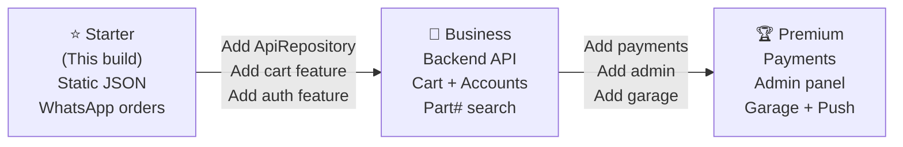

# AZZAB MOTO — Product Roadmap

> **Store:** عزاب موتو — TVS Motorcycle Spare Parts  
> **Reference:** Proposal (docs/proposal.pdf)

---

## Package Tiers

| Feature                                    | Starter | Business | Premium |
| ------------------------------------------ | :-----: | :------: | :-----: |
| Product catalog (browse + search by name)  |   ✅    |    ✅    |   ✅    |
| Product detail + compatibility info        |   ✅    |    ✅    |   ✅    |
| Browse by category                         |   ✅    |    ✅    |   ✅    |
| Vehicle selector (model / year / category) |   ✅    |    ✅    |   ✅    |
| WhatsApp order (prefilled message)         |   ✅    |    ✅    |   ✅    |
| Send part photo via WhatsApp CTA           |   ✅    |    ✅    |   ✅    |
| About / Contact / Privacy / Returns pages  |   ✅    |    ✅    |   ✅    |
| PWA (install prompt)                       |   ✅    |    ✅    |   ✅    |
| SEO (meta, OG, JSON-LD Product schema)     |   ✅    |    ✅    |   ✅    |
| Workshop discount strip                    |   ✅    |    ✅    |   ✅    |
| **Shopping cart**                          |   ❌    |    ✅    |   ✅    |
| **Favorites / wishlist**                   |   ❌    |    ✅    |   ✅    |
| **User accounts (register/login)**         |   ❌    |    ✅    |   ✅    |
| **Order history**                          |   ❌    |    ✅    |   ✅    |
| **Part number / barcode search**           |   ❌    |    ✅    |   ✅    |
| **Real-time inventory**                    |   ❌    |    ✅    |   ✅    |
| **Google Analytics / Meta Pixel**          |   ❌    |    ✅    |   ✅    |
| **Saved vehicle garage**                   |   ❌    |    ❌    |   ✅    |
| **Online payments (card / InstaPay)**      |   ❌    |    ❌    |   ✅    |
| **Admin panel (products, orders)**         |   ❌    |    ❌    |   ✅    |
| **Multi-branch / inventory locations**     |   ❌    |    ❌    |   ✅    |
| **Push notifications**                     |   ❌    |    ❌    |   ✅    |

---

## Phase Map

### Starter → Business Migration Checklist

1. Install `ApiRepository` implementations (see `src/services/interfaces/`)
2. Switch `features.cart`, `features.accounts`, `features.favorites` to `true` in `features.ts`
3. Un-stub the `cart/`, `accounts/`, `favorites/` feature folders
4. Add backend service (Node.js/Supabase/Firebase)
5. Update CSP `connect-src` to allow the API origin
6. Add cookie consent banner (required for analytics)
7. Update `docs/SECURITY.md` "Frontend Limits" section

### Business → Premium Migration Checklist

1. Switch `features.payments`, `features.adminPanel`, `features.garage` to `true`
2. Integrate payment gateway (InstaPay manual verification → automated in Premium)
3. Add push notification service worker subscription
4. Add admin panel routes (separate subdomain recommended)
5. Update privacy policy with payment data handling

---

## Delivery Timeline (estimated, not contractual)

| Phase     | Deliverable                               | Est. Duration |
| --------- | ----------------------------------------- | ------------- |
| 0         | Plan + architecture docs                  | ½ day         |
| 1         | Foundation (tools, schemas, data, config) | 1 day         |
| 2         | Layout (header, footer, router)           | 1 day         |
| 3         | Home page (all 9 sections)                | 1.5 days      |
| 4         | Catalog + search + vehicle selector       | 1.5 days      |
| 5         | Product page                              | 1 day         |
| 6         | Static pages + PWA                        | ½ day         |
| 7         | Security hardening                        | ½ day         |
| 8         | QA + Lighthouse + final docs              | 1 day         |
| **Total** | **Starter Store complete**                | **~8 days**   |

---

## Technical Debt Log

Items to address before Business launch (not blocking Starter):

- [ ] Replace `src/data/*.json` with API endpoints
- [ ] Add server-side rendering (Next.js migration) for better SEO
- [ ] Add structured error logging (Sentry)
- [ ] Add E2E tests (Playwright)
- [ ] Add image optimization pipeline (WebP, AVIF)
